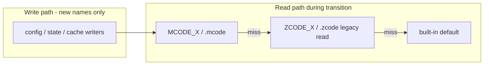

# MCode Deep Rebrand (Spec)

Status: DRAFT - specification only, not yet scheduled for implementation. This document is the collaboration surface for designing the rebrand; extend it in place.

## Goal & scope

Rename the product from ZCode to MCode at every layer we own: user-visible names, packaging identity, environment variable prefix (`MCODE_*`), package scope (`@mcode/*`), CLI binary (`mcode`), data and config directories (`~/.mcode`, workspace `.mcode`), internal IPC channels (`mcode:*`), and the renderer bridge (`window.mcode`). Every authorized or external compatibility surface stays untouched (see Preserve list) - z.ai login, stored credentials, wire protocol, the plugin ecosystem, and `zcode://` deep links must all keep working across the rename.

Guiding principle: **identifiers we promised to the outside world do not move; identifiers that are ours get renamed uniformly; version boundaries are bridged with dual-read aliases.**

## Naming decision table

| Category | Current | Target | Notes |
| --- | --- | --- | --- |
| Display name - i18n (~250 strings en+zh), component aria-labels, About, tray, web titles, CLI/TUI banner, agent self-identification (`"You are ZCode..."`) | ZCode | MCode | Pure copy changes. Single default-name definition at `packages/desktop/src/main/desktopRuntimeEnv.ts` (`ZCode` / `ZCode Dev` / `ZCode Preview` -> `MCode` / `MCode Dev` / `MCode Preview`). |
| Packaging identity (`packages/desktop/scripts/desktop-product-identity.mjs`) | appId `dev.zcode.app`, productName `ZCode`, linux exe/package `zcode` | `dev.mcode.app`, `MCode`, `mcode`, `mcode.desktop`, `Icon=mcode` | Old and new installers coexist; uninstalling the old build is a manual user step. Windows AppUserModelId and registry context-menu key rename with it. |
| Environment variables (~530 `ZCODE_*` keys) | `ZCODE_*` | `MCODE_*` | Dual-read alias during transition (see Migration). External scripts, CI, docs, `.env.local` examples move to `MCODE_*`. |
| Packages & directories | `@zcode/*` (40 packages, ~4,500 files), `apps/zcode-cli`, `packages/zcode-*` | `@mcode/*`, `apps/mcode-cli`, `packages/mcode-*` | Mechanical rename + lockfile/bin-link regeneration. No runtime persistence coupling. |
| CLI binary | `bin.zcode`, `CLI_COMMAND_NAME = "zcode"` | `mcode`, plus a `zcode` symlink shim to the same entry | Keeps muscle memory and existing scripts working. |
| Data directories | `~/.zcode` (v2 config, `credentials.json`, `cli/db`, sessions, memories, tasks-index, bots state), `~/.zcode-beta`, `~/Library/Caches/zcode` | `~/.mcode`, `~/.mcode-beta`, `~/Library/Caches/mcode` | One-time migration, reusing the `copyDataDirectory()` precedent in `packages/services/src/paths.ts`. |
| Workspace directories | `.zcode/` (skills, workflows, config kinds) | `.mcode/` | Read prefers `.mcode`, falls back to `.zcode`; lazy per-item copy on first hit; hook-trust records migrate with it. |
| IPC channels (164 `zcode:*`) | `zcode:*` | `mcode:*` | Internal to the app; renamed atomically with both sides shipping together. |
| Renderer bridge | `window.zcode` (public plugin API, `UI_PLUGIN.md`) | `window.mcode` primary + frozen `window.zcode` alias | Alias emits a one-time deprecation warning; third-party panels keep working. |
| Process name / User-Agent | `process.title`, `User-Agent: ZCode/${version}` | `MCode`, `User-Agent: MCode/${version}` | UA switch ships with a `ZCODE_USER_AGENT_LEGACY=1` rollback switch kept for one release cycle. |
| Deep-link scheme | `zcode://` (OS-registered; OAuth redirect) | ADD `mcode://`, KEEP `zcode://` | The OAuth redirect URI is registered server-side at z.ai and cannot change (see Preserve list). |

## Preserve list (MUST NOT RENAME)

1. **z.ai backend**: `https://zcode.z.ai`, `cdn-zcode.z.ai`, `/api/v1/zcode-plan*` paths, relay `wss://zcode.z.ai/api/v1/remote/ws2`.
2. **OAuth**: client_id `client_P8X5CMWmlaRO9gyO-KSqtg`, redirect `zcode://oauth/callback`.
3. **Credential decryption**: the derivation literal `zcode-credential-fallback:` stays verbatim; `MCODE_CREDENTIAL_SECRET` and legacy `ZCODE_CREDENTIAL_SECRET` dual-read the same value, producing the same AES-256-GCM key, so every stored `enc:v1:` credential decrypts without re-login. (`packages/services/src/credential/providers/credentialCipherProvider.ts`, `apps/zcode-cli/packages/adapters/src/auth/credential-cipher.ts`.)
4. **Wire protocol literals**: `ZCODE_PROTOCOL_NAME = "ZCode Protocol"`, `protocolVersion` literals, MCP auth type `zcode_official`, `zcode/*` MCP meta keys (`zcode/errorPresentation`, `zcode/browserScreenshotContentIndices`, ...).
5. **Plugin ecosystem**: marketplace id `zcode-plugins-official`, stable persisted plugin ids (`skill-creator@zcode-plugins-official`, ...), and the `window.zcode` bridge via the frozen alias.
6. **Backend contract headers**: `x-zcode-intranet-token`, `x-zcode-rpc-client-mode`, `x-zcode-rpc-host-capability`.
7. **`zcode://` scheme registration** - kept alongside the new `mcode://`.

## Migration design

- **Environment dual-read**: one helper `readEnv(name)` resolving `MCODE_<X> ?? ZCODE_<X>`; precedent: `ZCODE_SESSION_DB_PATH`/`ZCODE_SESSION_DB`. Writers (generated config, docs, scripts) emit `MCODE_*` only. Existing `.env.local` files (e.g. `ZCODE_BOT_STT_*` from the VoiceStudio setup) keep working unchanged through the alias window.
- **Data-directory migration**: on startup, if `~/.mcode` is absent and `~/.zcode` exists, copy the whole tree to `~/.mcode` and drop a marker file (schema version + timestamp). Copy failure fails open: fall back to the old directory and log a warning. Same treatment for `~/.zcode-beta` and the macOS cache dir.
- **Workspace `.zcode/`**: prefer `.mcode` on read; on first legacy hit, lazily copy items (skills/workflows/config) and repoint hook-trust records.
- **Binary shim**: `mcode` is the real entry point; `zcode` becomes a symlink/wrapper to it.
- **Bridge alias**: `window.mcode` is the primary object; `window.zcode` is an `Object.freeze` proxy over it logging one deprecation warning.
- **Credentials**: no data migration needed - see Preserve list item 3.

## Phased delivery

| Phase | Content | Exit criteria |
| --- | --- | --- |
| P0 | Display name to MCode everywhere (copy only) | typecheck/lint/architecture pass; UI screenshot review |
| P1 | Packaging identity (appId, exe, desktop entry, icon assets) | All three platforms produce correctly named artifacts and launch |
| P2 | `MCODE_*` dual-read + docs/scripts switch | Every legacy env var still effective; alias matrix unit-tested |
| P3 | Data-dir migration + credential secret alias + workspace `.mcode` | Seeded-data migration e2e; login works without re-auth |
| P4 | `@mcode/*` package & directory rename + lockfile/bin | Full-repo typecheck, tests, e2e green |
| P5 | IPC `mcode:*` + `window.mcode` (keep `zcode` alias) | Third-party plugin fixture loads via the alias |
| P6 | Cleanup: remove dual-read aliases (separate release) | Migration marker adoption verified at target level |

Each phase ships independently and reverts as a single commit revert. Phases must not be mixed within one commit.

## Upstream sync strategy

The fork continues to absorb `zai-org/ZCode`. Hand-merging after a deep rename is unrealistic, so the rename is maintained as a **replayable layer**: P0-P5 mechanical replacements are codified in a deterministic script `scripts/rebrand/apply-mcode.mjs` whose whitelist equals the Preserve list. Workflow per upstream merge: merge -> run the rebrand script -> typecheck/lint/tests. Script failures are treated as merge conflicts and resolved manually; bypassing the whitelist is not allowed.

## Risk register

- Credential derivation or secret read accidentally changed -> every stored credential becomes undecryptable. P3 acceptance must include decrypting a fixture credential written by the old version.
- OAuth redirect changed -> login dead-ends. The redirect is on the Preserve list and a review checkpoint.
- Plugin panels hardcode `window.zcode` -> ecosystem breakage. The frozen alias is a P5 exit criterion.
- Windows registry (`ZCode.OpenInZCode`) and CA cert `organizationName: "ZCode"` rename only on fresh installs; stale remnants on upgraded machines are harmless and not cleaned up.
- CI/CD, watchdog automation, `.env.local`, and e2e fixtures referencing `ZCODE_*` keep working through the alias window; they move to `MCODE_*` in P6.
- User-Agent/process-name changes could trip z.ai risk controls: ship behind `ZCODE_USER_AGENT_LEGACY=1` rollback for one release cycle.

## Verification

- Every phase: `pnpm typecheck`, `pnpm lint`, `pnpm architecture:check --changed`, affected unit tests.
- P3 focus: seeded `~/.zcode` tree (credentials.json, sessions, bot-state, db.sqlite) migration e2e + old-credential decrypt assertion.
- P5 focus: third-party plugin fixture loads through the `window.zcode` alias; both `mcode://` and `zcode://` deep links launch the app.
- Login regression: full OAuth flow (via the `zcode://` callback) completes inside the new package.
